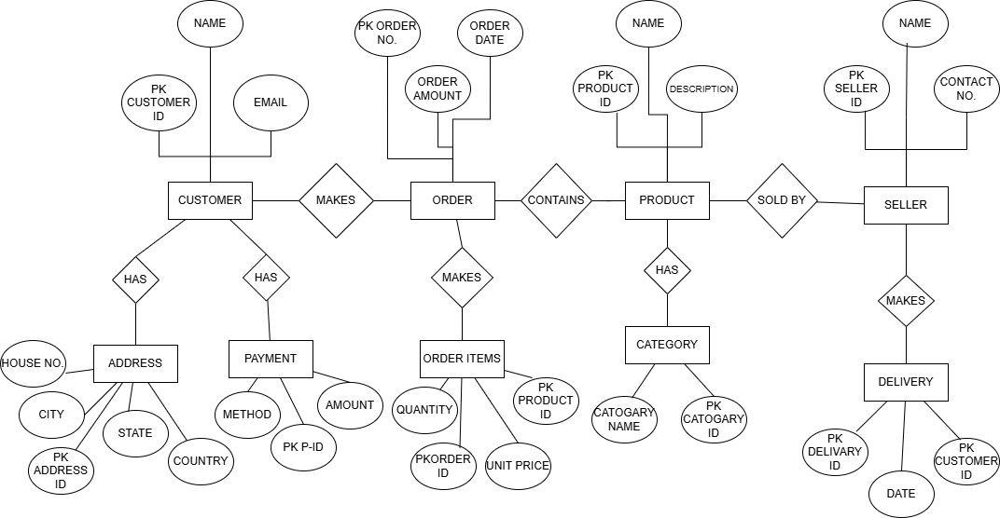
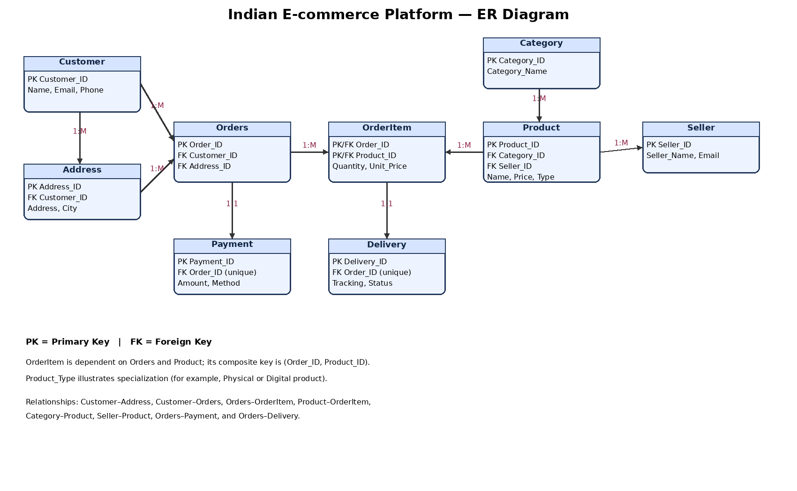

# Experiment 1: E-Commerce Database E-R Modeling & Relational Schema Implementation

> **Format**: This experiment is written and provided in executable `.sql` format ([experiment_01.sql](experiment_01.sql)).

## Aim
To design an Entity-Relationship (E-R) diagram for an Indian E-Commerce platform, convert the conceptual E-R model into a normalized relational schema, create tables in MySQL with primary key, foreign key, and cascading constraints, and populate sample records to verify data integrity.

---

## E-R Diagrams

### 1. Conceptual E-R Model (Draw.io)


### 2. Relational Entity Diagram


---

## Entities & Relationships

1. **Customer**: Represents registered users who browse and purchase products. Has an identified one-to-many relationship with `Address`.
2. **Address**: Stores delivery addresses associated with customers. Foreign key `Customer_ID` with `ON DELETE CASCADE`.
3. **Seller**: Merchants listing products on the e-commerce marketplace.
4. **Category**: Classification hierarchy for catalog products (e.g., Electronics, Accessories).
5. **Product**: Catalog items offered by sellers, tagged to a specific category.
6. **Orders**: Customer purchases linked to a delivery address.
7. **OrderItem**: Junction entity / weak entity resolving the many-to-many relationship between `Orders` and `Product`. Composite primary key `(Order_ID, Product_ID)`.
8. **Payment**: Financial transaction details for an order (UPI, Card, Net Banking). `1:1` relationship with `Orders`.
9. **Delivery**: Logistics tracking and shipping status for order fulfillment. `1:1` relationship with `Orders`.

---

## Relational Schema & Tables

| Table Name | Attributes (Data Types) | Primary Key | Foreign Keys & Actions |
|---|---|---|---|
| **Customer** | `Customer_ID` (INT AUTO_INCREMENT), `Full_Name` (VARCHAR 100), `Email` (VARCHAR 100 UNIQUE), `Phone` (VARCHAR 20) | `Customer_ID` | None |
| **Address** | `Address_ID` (INT AUTO_INCREMENT), `Customer_ID` (INT), `Address_Line` (VARCHAR 200), `City` (VARCHAR 60), `State` (VARCHAR 60), `Postal_Code` (VARCHAR 15) | `Address_ID` | `Customer_ID -> Customer(Customer_ID)` `ON DELETE CASCADE` |
| **Seller** | `Seller_ID` (INT AUTO_INCREMENT), `Seller_Name` (VARCHAR 100), `Email` (VARCHAR 100 UNIQUE) | `Seller_ID` | None |
| **Category** | `Category_ID` (INT AUTO_INCREMENT), `Category_Name` (VARCHAR 80 UNIQUE) | `Category_ID` | None |
| **Product** | `Product_ID` (INT AUTO_INCREMENT), `Product_Name` (VARCHAR 120), `Category_ID` (INT), `Seller_ID` (INT), `Product_Type` (VARCHAR 30), `Price` (DECIMAL 10,2) | `Product_ID` | `Category_ID -> Category(Category_ID)`, `Seller_ID -> Seller(Seller_ID)` |
| **Orders** | `Order_ID` (INT AUTO_INCREMENT), `Customer_ID` (INT), `Address_ID` (INT), `Order_Date` (DATETIME), `Order_Status` (VARCHAR 30) | `Order_ID` | `Customer_ID -> Customer(Customer_ID)`, `Address_ID -> Address(Address_ID)` `ON DELETE SET NULL` |
| **OrderItem** | `Order_ID` (INT), `Product_ID` (INT), `Quantity` (INT), `Unit_Price` (DECIMAL 10,2) | `(Order_ID, Product_ID)` | `Order_ID -> Orders(Order_ID)` `ON DELETE CASCADE`, `Product_ID -> Product(Product_ID)` |
| **Payment** | `Payment_ID` (INT AUTO_INCREMENT), `Order_ID` (INT UNIQUE), `Payment_Date` (DATETIME), `Amount` (DECIMAL 10,2), `Payment_Method` (VARCHAR 30), `Payment_Status` (VARCHAR 30) | `Payment_ID` | `Order_ID -> Orders(Order_ID)` `ON DELETE CASCADE` |
| **Delivery** | `Delivery_ID` (INT AUTO_INCREMENT), `Order_ID` (INT UNIQUE), `Tracking_Number` (VARCHAR 60 UNIQUE), `Delivery_Status` (VARCHAR 30) | `Delivery_ID` | `Order_ID -> Orders(Order_ID)` `ON DELETE CASCADE` |

---

## How to Execute the Script

### Using MySQL Command-Line Client
```bash
mysql -u your_username -p < experiment_01.sql
```

### Using MySQL Workbench
1. Open MySQL Workbench and connect to your MySQL Server instance.
2. Go to **File -> Open SQL Script...** and select `experiment_01.sql`.
3. Execute the script (`Ctrl+Shift+Enter`).
4. Review the returned Result Grids for the verification `SELECT` queries across all 9 tables.

