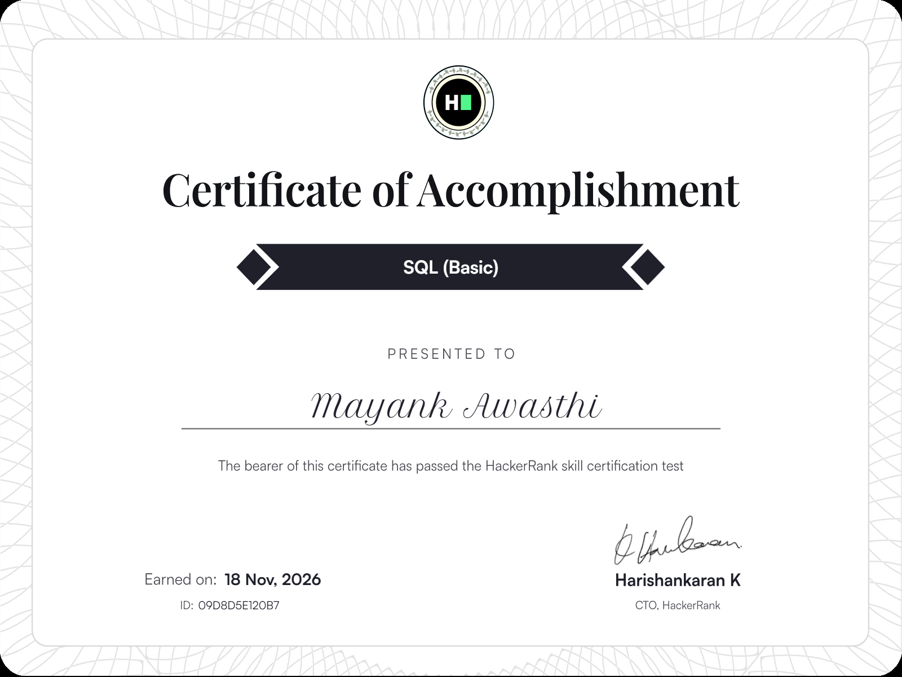
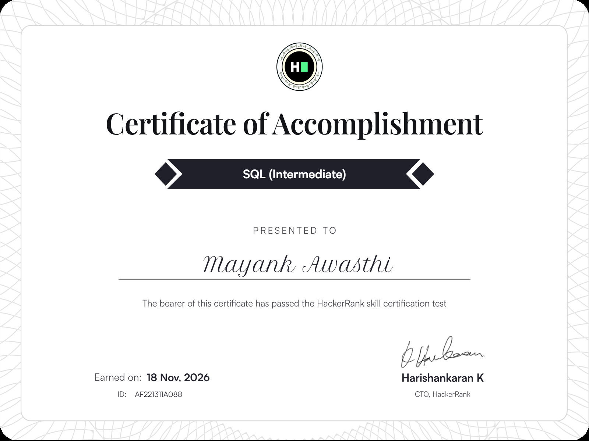

# Professional SQL Certifications

This directory contains verified professional industry certifications in **SQL, Database Design, and Query Optimization** awarded by **HackerRank** and **Infosys Springboard**.

---

## Certifications Summary

| # | Credential / Subject | Issuing Authority | Skill Level | Earned Date | Credential ID / Verification | File Links |
|:---:|:---|:---|:---:|:---:|:---:|:---:|
| **1** | **SQL (Basic)** | HackerRank | Basic | Nov 18, 2026 | `09D8D5E120B7` | [PDF](hackerrank/sql_basic_certificate.pdf) • [PNG](hackerrank/sql_basic_certificate.png) |
| **2** | **SQL (Intermediate)** | HackerRank | Intermediate | Nov 18, 2026 | `AF221311A088` | [PDF](hackerrank/sql_intermediate_certificate.pdf) • [PNG](hackerrank/sql_intermediate_certificate.png) |
| **3** | **SQL (Advanced)** | HackerRank | Advanced | Nov 18, 2026 | `914D66ED9DB0` | [PDF](hackerrank/sql_advanced_certificate.pdf) • [PNG](hackerrank/sql_advanced_certificate.png) |
| **4** | **SQL in FSD Development** | Infosys Springboard | Professional | Nov 18, 2026 | [verify.onwingspan.com](https://verify.onwingspan.com) | [PDF](infosys%20springboard/sql_in_fsd_development_certificate.pdf) • [PNG](infosys%20springboard/sql_in_fsd_development_certificate.png) |

---

## Directory Organization

```
certification/
├── hackerrank/
│   ├── README.md
│   ├── sql_basic_certificate.pdf
│   ├── sql_basic_certificate.png
│   ├── sql_intermediate_certificate.pdf
│   ├── sql_intermediate_certificate.png
│   ├── sql_advanced_certificate.pdf
│   └── sql_advanced_certificate.png
└── infosys springboard/
    ├── README.md
    ├── sql_in_fsd_development_certificate.pdf
    └── sql_in_fsd_development_certificate.png
```

---

## 1. HackerRank Certifications

Comprehensive mastery across SQL fundamentals, intermediate joins and subqueries, and advanced query engineering, stored routines, and recursive querying.

### SQL (Basic)
- **Credential ID**: `09D8D5E120B7`
- **Focus Areas**: Selection, filtering (`WHERE`), pattern matching (`LIKE`), sorting (`ORDER BY`), scalar operations, and aggregate functions (`COUNT`, `SUM`, `AVG`, `MIN`, `MAX`).
- [View Full Certificate (PDF)](hackerrank/sql_basic_certificate.pdf)



### SQL (Intermediate)
- **Credential ID**: `AF221311A088`
- **Focus Areas**: Multi-table relational joins (`INNER`, `LEFT`, `RIGHT`, `FULL`), nested subqueries, correlated subqueries, set operations, and grouped aggregation with `HAVING`.
- [View Full Certificate (PDF)](hackerrank/sql_intermediate_certificate.pdf)



### SQL (Advanced)
- **Credential ID**: `914D66ED9DB0`
- **Focus Areas**: Window functions (`ROW_NUMBER`, `DENSE_RANK`, `LEAD`/`LAG`), recursive CTE hierarchies, query optimization strategies, procedural blocks, and complex analytics.
- [View Full Certificate (PDF)](hackerrank/sql_advanced_certificate.pdf)


---

## 2. Infosys Springboard Certification

### SQL in Full Stack Development (FSD)
- **Course**: SQL in FSD Development
- **Issuing Body**: Infosys Springboard (Infosys Limited)
- **Issued Date**: November 21, 2026
- **Credential Verification**: [https://verify.onwingspan.com](https://verify.onwingspan.com)
- **Focus Areas**: Relational database architecture for modern full-stack web applications, schema design, ACID transactions, data persistence, and SQL query efficiency in backend services.
- [View Full Certificate (PDF)](infosys%20springboard/sql_in_fsd_development_certificate.pdf)


