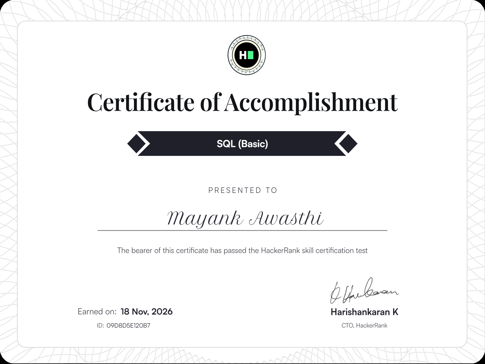
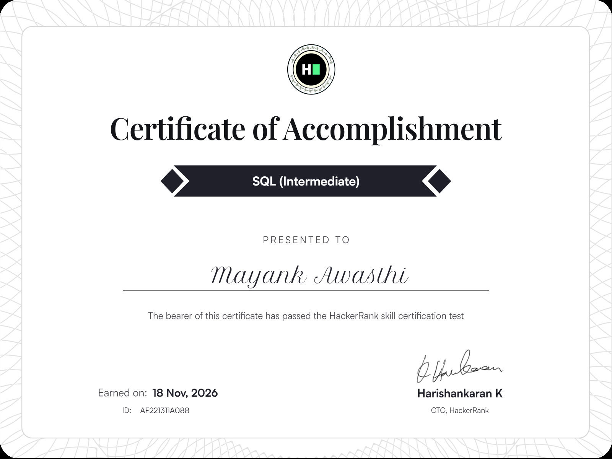

# HackerRank SQL Certifications

This folder contains the complete 3-tier HackerRank SQL certification series earned by **Mayank Awasthi**.

---

## Certification Progression

```
┌─────────────────────────┐       ┌──────────────────────────────┐       ┌────────────────────────────┐
│   HackerRank SQL Basic  │  ──>  │ HackerRank SQL Intermediate  │  ──>  │  HackerRank SQL Advanced   │
│   ID: 09D8D5E120B7      │       │ ID: AF221311A088             │       │  ID: 914D66ED9DB0          │
└─────────────────────────┘       └──────────────────────────────┘       └────────────────────────────┘
```

---

## Certificates

### 1. SQL (Basic)
- **Awarded To**: Mayank Awasthi
- **Date Earned**: November 18, 2026
- **Credential ID**: `09D8D5E120B7`
- **Verified Skills**: Basic SQL querying, filtering clauses, sorting, aggregate functions, and relational arithmetic.
- **Files**:
  - [Download PDF Certificate](sql_basic_certificate.pdf)
  - [View High-Res PNG](sql_basic_certificate.png)



---

### 2. SQL (Intermediate)
- **Awarded To**: Mayank Awasthi
- **Date Earned**: November 18, 2026
- **Credential ID**: `AF221311A088`
- **Verified Skills**: Multi-table relational joins, correlated and scalar subqueries, grouped aggregations, and conditionally formatted result sets.
- **Files**:
  - [Download PDF Certificate](sql_intermediate_certificate.pdf)
  - [View High-Res PNG](sql_intermediate_certificate.png)



---

### 3. SQL (Advanced)
- **Awarded To**: Mayank Awasthi
- **Date Earned**: November 18, 2026
- **Credential ID**: `914D66ED9DB0`
- **Verified Skills**: Window functions, ranking algorithms, recursive common table expressions (CTEs), enterprise query optimization, and performance tuning.
- **Files**:
  - [Download PDF Certificate](sql_advanced_certificate.pdf)
  - [View High-Res PNG](sql_advanced_certificate.png)


