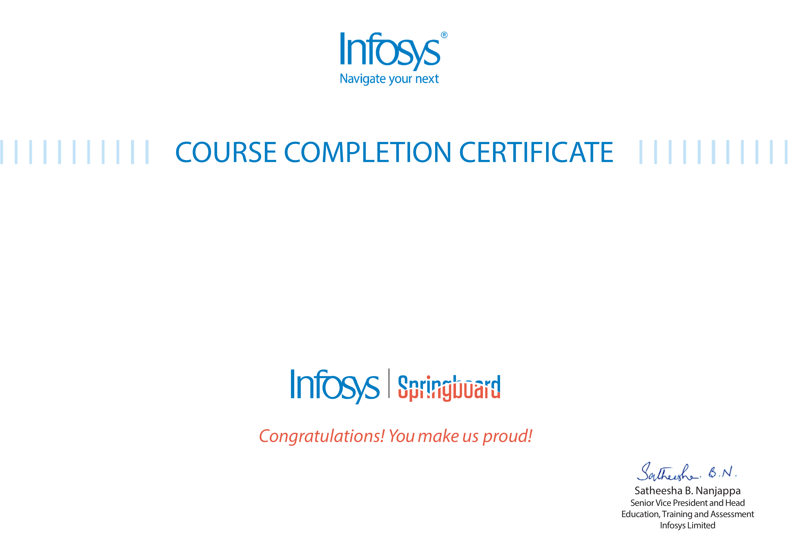

# Infosys Springboard Certification

This folder contains the verified course completion certificate for **SQL in FSD Development** from **Infosys Springboard** awarded to **Mayank Mayank**.

---

## Certificate Overview

- **Course Title**: SQL in FSD Development
- **Issuing Organization**: Infosys Limited (Infosys Springboard)
- **Awarded To**: Mayank Mayank
- **Completion Date**: November 18, 2026
- **Issue Date**: Saturday, November 21, 2026
- **Verification Authority**: Satheesha B. Nanjappa (Senior Vice President and Head - Education, Training and Assessment, Infosys Limited)
- **Online Verification**: Verify via QR code or direct portal at [https://verify.onwingspan.com](https://verify.onwingspan.com)

---

## Skills & Topics Covered

- Relational database management systems (RDBMS) for Full Stack Web Applications.
- Database modeling, normalization, table relationships, and referential constraints.
- Optimized query design for backend API consumption and data-driven web services.
- Data consistency, transaction management, and indexing best practices.

---

## Files

- [Download Certificate (PDF)](sql_in_fsd_development_certificate.pdf)
- [View High-Resolution Preview (PNG)](sql_in_fsd_development_certificate.png)

